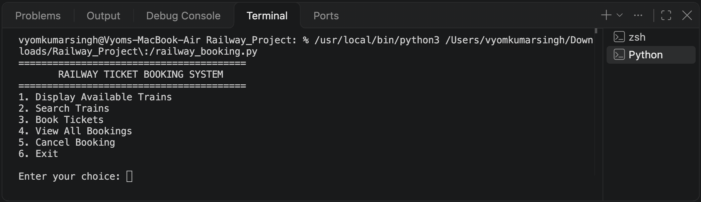

# 🚆 Railway Ticket Booking System

A Python-based Railway Ticket Booking System that simulates the basic process of searching for trains, booking tickets, managing passenger details, and cancelling reservations.

This project was developed as a Python mini-project to apply fundamental programming concepts to a practical, real-world-inspired problem.

## ✨ Features

- **Display Available Trains:** View train numbers, names, routes, fares, and available seats.
- **Search Trains:** Search for trains using source and destination stations.
- **Multiple Passenger Booking:** Book tickets for multiple passengers in a single transaction.
- **Automatic Fare Calculation:** Calculate the total fare based on the number of passengers.
- **Booking ID Generation:** Generate a unique booking ID for each booking.
- **Seat Management:** Automatically update available seats after booking or cancellation.
- **View Bookings:** Display all current bookings and passenger details.
- **Cancel Bookings:** Cancel a booking using its booking ID and restore the seats.

## 🛠️ Technologies Used

- **Programming Language:** Python 3
- **Code Editor:** Visual Studio Code
- **Version Control:** Git and GitHub

## 📚 Python Concepts Used

| Concept | How it is used |
|---|---|
| Variables | Store train details, passenger information, fares, and booking IDs. |
| Data Types | Use strings, integers, and Boolean values. |
| Input and Output | Take user input and display information using `input()` and `print()`. |
| Type Conversion | Convert numeric input using `int()`. |
| Lists | Store trains, available seats, passengers, and bookings. |
| Tuples | Store train and passenger details. |
| Indexing | Access specific elements from lists and tuples. |
| Conditional Statements | Use `if`, `elif`, and `else` to make decisions. |
| For Loops | Iterate through trains, passengers, and bookings. |
| While Loop | Keep the main menu running until the user exits. |
| Range and Len | Control loop iterations based on the number of elements. |
| Functions | Organize the program into reusable operations. |
| String Methods | Use `strip()` and `lower()` for station searches. |
| List Methods | Use `append()` and `remove()` to manage records. |
| Break and Return | Exit loops or functions when required. |
| Operators | Perform fare calculations, comparisons, and seat updates. |

## 💻 How to Run the Project

1. Install Python 3 on your computer.
2. Download or clone this repository.
3. Open the project folder in Visual Studio Code.
4. Open the terminal.
5. Run the following command:

```bash
python3 railway_booking.py
```

## 📸 Project Screenshot



## 🧾 Sample Booking Output

```text
========== BOOKING CONFIRMED ==========

Booking ID: 1001
Train: Vande Bharat
Route: Delhi to Varanasi

Passenger Details:
Name: Rahul
Age: 20
Name: Aman
Age: 19

Total Passengers: 2
Total Fare: Rs. 2400
Remaining Seats: 98
```

*Sample demonstration: two passengers booked on Vande Bharat (Train 103).*

## ⚠️ Project Disclaimer

This project is an educational simulation of a railway ticket booking system. It does not connect to Indian Railways or make real train reservations. Booking information is stored temporarily in memory and resets when the program is closed.

## 👨‍💻 Author

Created as a Python mini-project to practise programming fundamentals and problem-solving.